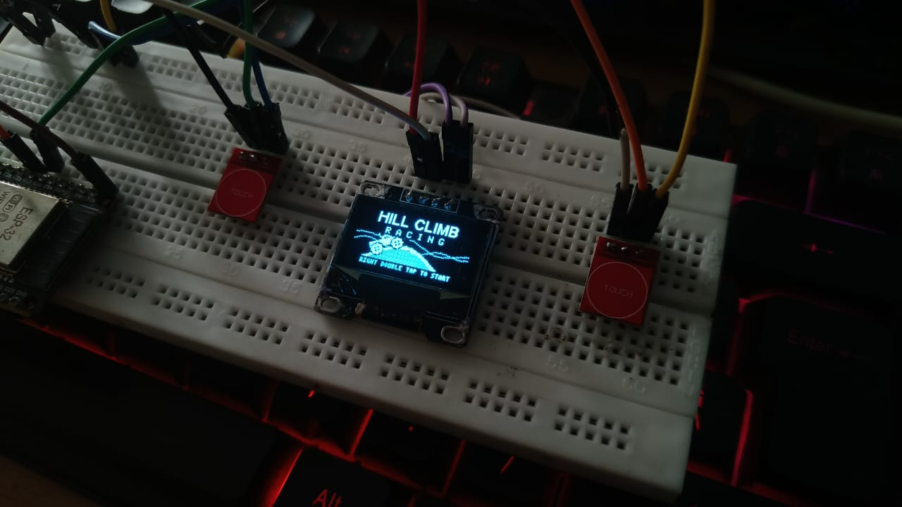
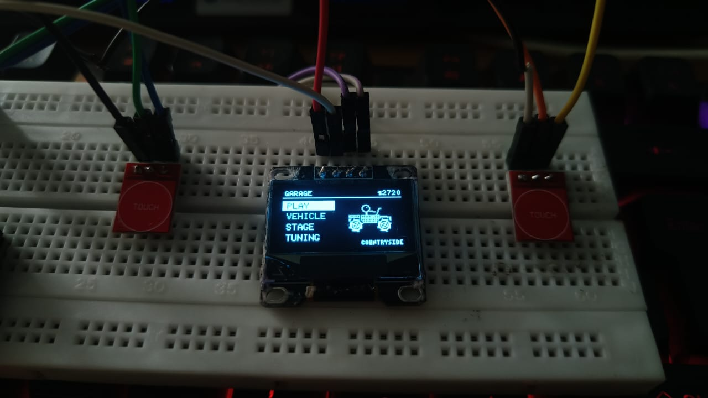
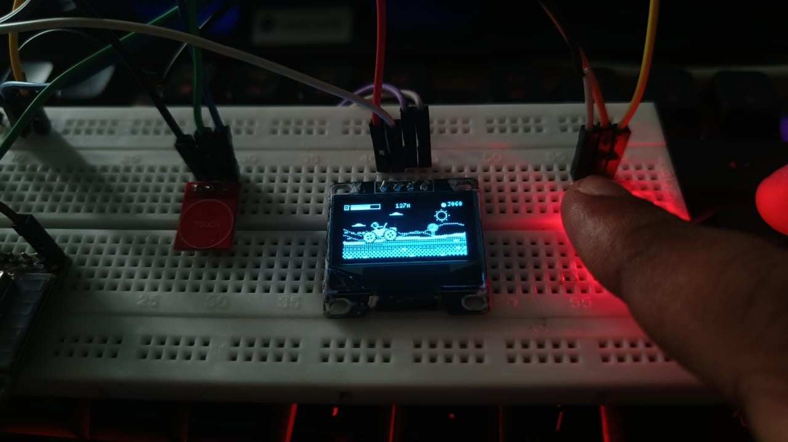
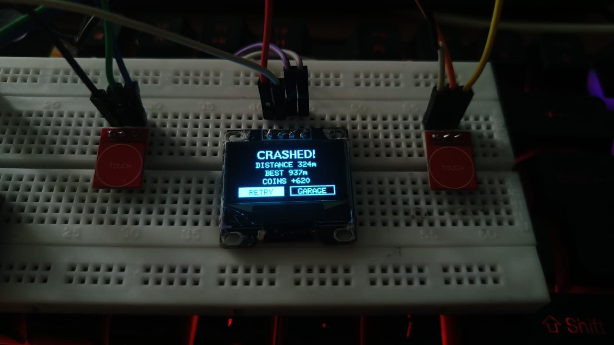
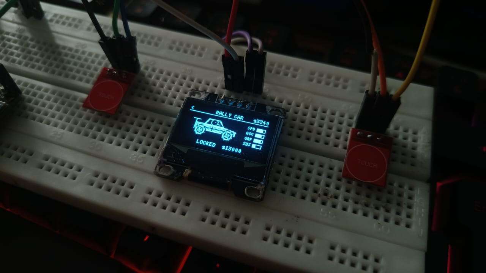
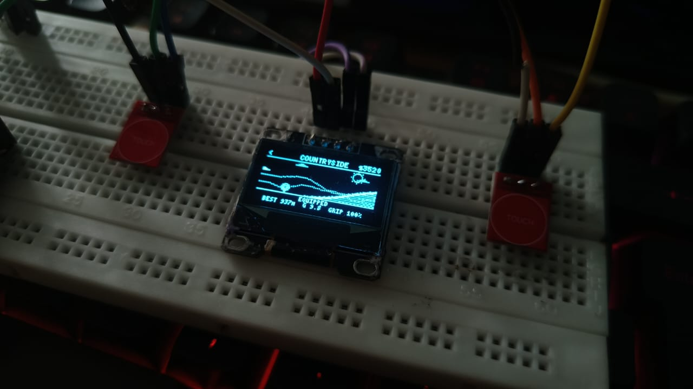

# 🏔️ Hill Climb Racing — ESP32 OLED Edition

**A physics-driven, fully playable hill-climbing racer that runs on an ESP32, a tiny OLED and two touch pads.**
8 vehicles · 8 stages · full tuning · persistent coins · ~60 fps

**Maintainer:** [@arcobitx-labs](https://github.com/arcobitx-labs) · [Email](mailto:arcobitxlabs@gmail.com)  
**Collaborator:** [@abhijithk-ak](https://github.com/abhijithk-ak)  
**Repository:** [arcobitx-labs/hill-climb-racing-esp32](https://github.com/arcobitx-labs/hill-climb-racing-esp32)

---

## 📸 Gallery

The gallery below uses the project photos in [`images/`](images).

<table>
  <tr>
    <td align="center"> <b>Title screen &amp; hardware</b></td>
    <td align="center"> <b>Garage menu</b></td>
    <td align="center"> <b>Gameplay</b></td>
  </tr>
  <tr>
    <td align="center"> <b>Crash screen</b></td>
    <td align="center"> <b>Vehicle selection</b></td>
    <td align="center"> <b>Countryside stage</b></td>
  </tr>
</table>

| Slot | Image | What it shows |
|---|---|---|
| 1 | [`images/img1.jpeg`](images/img1.jpeg) | Title screen and hardware |
| 2 | [`images/img2.jpeg`](images/img2.jpeg) | Garage menu |
| 3 | [`images/img3.jpeg`](images/img3.jpeg) | Gameplay |
| 4 | [`images/img4.jpeg`](images/img4.jpeg) | Crash screen |
| 5 | [`images/img5.jpeg`](images/img5.jpeg) | Vehicle selection |
| 6 | [`images/img6.jpeg`](images/img6.jpeg) | Countryside stage |

---

## ✨ Features

### 🎮 Gameplay
- **Real physics engine** at a fixed 120 Hz: rigid-body chassis, spring-damper suspension on every wheel, wheel traction limited by grip, engine power curve, air drag, and body/ground collisions.
- **Driver ragdoll-lite:** the driver's head bobs and sways with acceleration, bumps and landings. Touch the ground with your head (or roof) and it's game over.
- **Every vehicle drives differently:** mass, power, top speed, suspension frequency and damping, travel, grip, drive type (RWD / AWD) and air control are all unique.
- **Fuel system:** collect fuel cans or run dry. Gas burns fuel faster than idling.
- **Coins:** silver coins (+10) and gold bundles (+100).
- **Stunt bonuses:** front/back flips (+100 each), air time (+40) and wheelies (up to +100) with on-screen pop-ups.
- **Distance signs** every 100 m and a **best distance** record per stage.
- **Crash page** with distance, best, coins earned, and Retry / Garage.
- **Pause menu** (hold both pads for 3 s): Resume, Restart, Quit.

### 🌍 8 stages
| # | Stage | Gravity | Grip | Unlock | Highlights |
|---|---|---|---|---|---|
| 1 | Countryside | 9.81 | 100 % | free | rolling hills, grass, stones, trees |
| 2 | Desert | 9.81 | 85 % | 1 500 | sharp dunes, sand strata, cacti, pyramids |
| 3 | Arctic | 9.81 | 45 % | 3 500 | very slippery, thick snow, pines, aurora, snowfall |
| 4 | Cave | 9.81 | 90 % | 6 000 | rocky ceiling with stalactites, headlight beam, glow dots |
| 5 | City | 9.81 | 105 % | 9 000 | rooftops joined by ramps, window facades, skyline |
| 6 | Moon | 1.62 | 90 % | 13 000 | craters, floaty low gravity, Earth in the sky |
| 7 | Mars | 3.71 | 100 % | 18 000 | rugged rock, boulders, twin moons |
| 8 | Volcano | 9.81 | 80 % | 25 000 | jagged ridges, lava veins, embers, smoking cone |

Terrain is generated endlessly and gets steeper the farther you drive.

### 🚗 8 vehicles
| # | Vehicle | Mass | Base top speed | Drive | Unlock |
|---|---|---|---|---|---|
| 1 | Hill Climber (jeep) | 1 000 kg | ~86 km/h | RWD | free |
| 2 | Motocross | 240 kg | ~101 km/h | RWD | 1 500 |
| 3 | Tractor | 1 600 kg | ~54 km/h | RWD | 3 500 |
| 4 | Monster Truck | 2 400 kg | ~76 km/h | AWD | 6 000 |
| 5 | Dune Buggy | 800 kg | ~97 km/h | RWD | 9 000 |
| 6 | Rally Car | 1 100 kg | ~112 km/h | AWD | 13 000 |
| 7 | Race Car | 850 kg | ~137 km/h | AWD | 18 000 |
| 8 | Bus | 4 000 kg | ~61 km/h | RWD | 25 000 |

### 🔧 Tuning (per vehicle, saved)
| Upgrade | Levels | Cost per level | Effect per level |
|---|---|---|---|
| Engine | 5 | 200 / 500 / 1 000 / 2 000 / 4 000 | +14 % drive force, +3.5 % top speed |
| Suspension | 5 | 200 / 500 / 1 000 / 2 000 / 4 000 | +6 % travel, more damping |
| Tires | 5 | 200 / 500 / 1 000 / 2 000 / 4 000 | +7 % grip |
| 4WD | 3 | 500 / 1 500 / 3 000 | shifts drive to the front wheels, +5 % force |

### 🖼️ Graphics (on a 1-bit 128×64 screen)
- World-anchored **dither textures** that scroll with the ground: soil, sand strata, ice glints, cracked cave rock, brick and windows, regolith, boulders, lava veins.
- **Parallax backgrounds** per stage: clouds, sun, mountains, skyline, planets, volcano and smoke.
- Scenery props, particles (dust, snow spray, smoke, sparks, embers), speed lines, camera shake on hard landings.
- Dithered metal body shading, animated tyre treads and wheel spokes, visible suspension struts, spinning coins.
- Smooth motion: physics interpolation, ~62 fps cap, display transfer on the second core.

### 💾 Saving
Coins, owned vehicles and stages, upgrades and best distances are stored in flash (ESP32 NVS) with a checksum. Coins are flushed within ~2.5 s of pickup, and on every purchase, pause and crash, so a power cut loses at most a couple of seconds.

---

## 🕹️ Controls

Two touch pads, no buttons.

| Where | Left pad | Right pad |
|---|---|---|
| Menus | single tap: previous | single tap: next |
| Menus | **double tap: back** | **double tap: select / buy / equip** |
| Race | **hold: brake / reverse**, lean nose down in the air | **hold: gas**, lean nose up in the air |
| Race | hold **both** for 3 s: pause | hold **both** for 3 s: pause |
| Boot | hold both while powering on for 3 s: **factory reset** | |

Handy flight tips: release gas in the air to stop rotating, tap brake to settle the nose, and brake to pull a wheelie back down.

---

## 🧰 Hardware

| Part | Notes |
|---|---|
| ESP32 WROOM-32 dev board | tested board |
| 0.96" SSD1306 **or** 1.3" SH1106 OLED, 128×64, I²C | pick one in the config |
| 2 × TTP223 touch modules | momentary, active-HIGH mode (factory default) |

### Wiring
| Signal | ESP32 pin |
|---|---|
| OLED SDA | GPIO 21 |
| OLED SCL | GPIO 22 |
| OLED VCC / GND | 3V3 / GND |
| Left touch OUT | GPIO 32 |
| Right touch OUT | GPIO 33 |
| Touch VCC / GND | 3V3 / GND |

---

## 🚀 Build & flash

1. Install the **Arduino IDE** and the **ESP32 board package** (Espressif).
2. Install the **U8g2** library (Library Manager).
3. Open [`hill_climb_racing.ino`](hill_climb_racing.ino).
4. Select **Tools → Board → ESP32 Dev Module**, choose your port, and upload.
5. If you use the 1.3" SH1106, set `USE_SH1106` to `1` first (see below).

> The sketch forward-declares `struct Vehicle; struct Stage; struct Poly;` near the top. This is required: the Arduino builder auto-generates function prototypes above the struct definitions. Keep those lines.

---

## 🎛️ Customize it

Everything below is near the top of `hill_climb_racing.ino`.

### Hardware & feel
| Setting | Default | What it does |
|---|---|---|
| `USE_SH1106` | `0` | `0` = SSD1306 (0.96"), `1` = SH1106 (1.3") |
| `PIN_SDA`, `PIN_SCL` | `21`, `22` | I²C pins |
| `PIN_TOUCH_L`, `PIN_TOUCH_R` | `32`, `33` | touch pad pins |
| `TOUCH_ACTIVE` | `HIGH` | set `LOW` if your pads are active-low |
| `I2C_SPEED` | `800000UL` | lower to `400000UL` if the screen glitches, raise to `1000000UL` to try for more speed |
| `TAP_MAX_MS` | `280` | longest press that still counts as a tap |
| `DOUBLE_GAP_MS` | `260` | max gap between two taps for a double tap |
| `PAUSE_HOLD_MS` | `3000` | how long to hold both pads to pause |
| `SAVE_INTERVAL_MS` | `2500` | how often pending coins are flushed to flash |
| `FRAME_US` | `16000` | frame time cap (16 000 µs ≈ 62 fps) |
| `SC` | `10.0f` | zoom in pixels per metre (bigger = bigger vehicles, less view) |
| `PHYS_DT` | `1/120` | physics step |

### Vehicles (`VEH[]` table)
Each entry controls both the look and the handling:

- **Performance:** `mass`, `fmax` (drive force N), `vmax` (top speed m/s), `mu` (grip), `drive` (0 RWD, 1 FWD, 2 AWD), `fuel`.
- **Suspension:** `travel`, `freq` (spring Hz), `zeta` (damping), wheel radii `rr`/`rf`, anchor points.
- **Feel:** `airK` (air-control strength).
- **Look:** `hull` collision points, `poly` body panels (colour `1` = shaded metal, `0` = black cut-out), `lines`, wheel arch (`arch`), tyre tread (`knob`), driver head/seat/hand/foot positions, exhaust position.
- **Economy:** `price`.

> Rule of thumb for a level ride: keep `anchorY - wheelRadius` equal for both wheels.

### Stages (`STAGES[]` table)
`g` (gravity), `grip`, hill amplitudes `a0..a2` and frequencies `f0..f2`, `rough`, `price`, and `camBias` (camera offset, used by the cave). The terrain shape lives in `terrainH()`, the ground texture in `texPix()`, props in `drawDecor()`, and the sky in `drawBackground()`.

### Economy
- Upgrade prices: `UPG_COST[][]`, level caps: `UPG_MAX[]`.
- Pickup frequency and values: `spawnItems()` and `collectItems()`.
- Stunt rewards: `award(...)` calls inside `physicsStep()`.

### Adding a vehicle or stage
1. Increase `NV` or `NS` and add a table entry.
2. Ownership is stored in 8-bit masks (`vehOwned`, `stageOwned`), so **8 is the cap**. To go beyond it, change those two fields to `uint16_t`.
3. Change `SAVE_MAGIC` so old saves are discarded cleanly.
4. For a new stage, add a case in `texPix()`, `drawBackground()` and `drawDecor()`, and a branch in `terrainH()`.

---

## 🧠 How it works

| Piece | Approach |
|---|---|
| Physics | Fixed 120 Hz semi-implicit Euler; chassis rigid body; per-wheel spring-damper acting along the ground normal; friction-limited traction applied at the wheel; point-contact hull collisions; spring-damper driver head. |
| Terrain | Procedural height function per stage; cached per screen column. |
| Rendering | Direct writes to the u8g2 frame buffer for terrain, scanline polygon fill with ordered (Bayer) dither for bodies. |
| Display | Frame copied to a transmit buffer and sent by a FreeRTOS task on core 0 while core 1 draws the next frame. |
| Saving | Single struct in NVS with FNV-1a checksum; invalid data falls back to defaults. |
| Input | Tap, double-tap and hold detection per pad. |

---

## 🛠️ Troubleshooting

| Problem | Fix |
|---|---|
| Blank or garbled screen | check `USE_SH1106`, wiring, then try `I2C_SPEED 400000UL` |
| Controls inverted or stuck | set `TOUCH_ACTIVE` to `LOW`, check the module is in momentary mode |
| `'Vehicle' does not name a type` | keep the forward declarations near the top of the sketch |
| Progress reset after an update | the save format changed (new `SAVE_MAGIC`); it's expected |

---

## 🤝 Contributing

Pull requests are welcome: new vehicles, stages, textures, balance tweaks, and ports to other displays (colour SPI TFTs would look amazing). Please keep the sketch a single file that compiles in the Arduino IDE.

---

## 📜 License — Open Source

This project is **free and open source** under the **[MIT License](LICENSE)**. You can use, modify, share and even sell it, as long as you keep the copyright notice and license text.

### Disclaimer
This is an independent, non-commercial fan project inspired by the mobile game *Hill Climb Racing*. It is **not affiliated with, endorsed by, or connected to Fingersoft**. All code, graphics and physics here were written from scratch. "Hill Climb Racing" is a trademark of its respective owner; consider giving your build its own name if you publish it widely.

### Credits
- [U8g2](https://github.com/olikraus/u8g2) by Oliver Kraus (BSD-2-Clause)
- Espressif Arduino-ESP32 core

---

**If you build one, add a photo to the gallery and share it. Happy climbing! 🏁**

